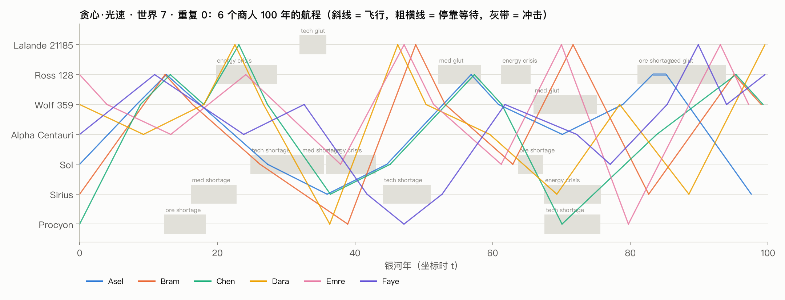

# 光速商人：相对论星际贸易的 headless 涌现实验



6 个商人在 7 颗真实近邻恒星之间做生意。信息只以光速传播，飞船有时间膨胀，每次加速和减速都要付 E = 2(γ−1)mc² 的能量。主体是 LLM 商人，每人一份独立 context，用 tool use 行动，保留采样随机性；另设贪心商人和 c→∞ 两类对照，用来区分哪些现象来自推理、哪些只在有限光速下才会出现。只做实验，不做 UI。

结论见 [发现](#发现)；完整数据报告（图和表）在 `reports/`。

## 快速开始

```bash
uv venv --python 3.14 .venv && source .venv/bin/activate && uv pip install -e ".[dev]"
pytest                                   # 50 个测试，约 3 秒

# 贪心基线：不调 LLM，几秒钟跑完 20 个世界 × 3 组
python -m reltrade.experiment --conditions greedy-light,greedy-ansible,greedy-newton --seeds 1-20

# LLM 商人：OpenCode Go 的 deepseek-v4.1-flash；key 由 go.sh 在运行时注入环境变量，不进仓库
~/.claude/skills/opencode-go/scripts/go.sh exec -- \
  python -m reltrade.experiment --conditions llm-light,llm-ansible,llm-newton --seeds 7 --replicates 3

# 分析：指标、图、中文数据报告
python -m reltrade.analysis --runs runs --out reports/<name>
```

已完成的 run（目录里有 `result.json`）会被跳过。中断的 run 重跑时从头重放：已缓存的 LLM 响应原样复用，不花钱，结果也和原来完全一致；未缓存的部分才会真正发请求。`--offline` 只读缓存。

## 世界

| 项 | 设定 | 说明 |
|---|---|---|
| 参考系 | 所有星站静止于同一惯性系，共用坐标时 t；只有船有固有时 τ，dτ/dt = √(1−β²) | handoff 提案，采纳 |
| 星图 | Sol、α Cen、Wolf 359、Lalande 21185、Ross 128、Sirius、Procyon，用真实三维坐标（J2000 赤经、赤纬、距离） | 两两相距 3.9–13.1 ly，比提案的 1–10 ly 略远。这 7 颗天然分成三团：核心（Sol / α Cen）、红矮星团（Wolf / Lalande / Ross，彼此 3.9–6.6 ly）、亮星对（Sirius / Procyon，5.3 ly） |
| 飞船 | 0 秒内加速到任意亚光速、匀速滑行、瞬时停下；E = 2(γ−1)(m_船 + m_货)c²，出发时一次付清（含减速） | handoff 决定 |
| 商品 | ore（重：0.008 M/单位）、tech（轻：0.0015）、med（0.003，**按船时 τ 半衰，半衰期 3 年**） | 船上的东西按 τ 计，船外的东西按 t 计 |
| 船员工资 | 每船时年 20¢，停靠和飞行都算；飞行工资出发时按该航程的 dτ 预付 | 时间膨胀进入成本的第二条通道：飞得快 → 船时短 → 工资省 |
| 市场 | 价格 × 库存 = 常数；大单沿曲线成交（积分计价，拆单无利可图）；买卖价差 4%；库存以 2 年时间常数回归正常水平 | 「本地价格按库存调整」 |
| 能源 | 各星站一个能源市场，买得越多越贵；Sirius 最便宜（3¢/单位），Wolf 359 最贵（35¢） | 便宜能源故意放在边缘，避免「几何中心」和「能源便宜」两个枢纽成因混在一起 |
| 外生波动 | 各市场的正常库存乘一个 OU 噪声（σ = 0.15，相关时间 5 年）；约每 6 年一次冲击（短缺 ×0.2–0.35、过剩 ×2.5–4、能源危机），持续 3–10 年，上新闻 | 全部按 seed 预先生成，与商人行为无关，任何一局都能精确重放 |
| 资金 | 现金随船携带，不计息 | Krugman《The Theory of Interstellar Trade》（Economic Inquiry 2010）的第一定理已核实：在途货物的利息按行星钟（坐标时）计算。本实验没有资本市场，所以先不设利息；资金的时间价值只体现在「100 年终局前能做几趟」 |
| 终局 | 第 100 银河年，净值 = 现金 + 货物在所在星站的清算价值；仍在飞的按目的地价格、扣掉腐败后清算 | |

## 信息与决策

- **光锥过滤**：事件日志里的每个事件都带 (地点, 时刻)。位于 (x_S, t) 的观察者只知道满足 |x_e − x_S| ≤ c(t − t_e) 的事件。远方星站的报价就是它在推迟时刻 t − d/c 的状态（库存历史只追加、不改写），报告里都标明数据年龄。
- **只在停靠时决策**：到港或等待结束时触发。报告包括：本站实时行情、各站光速延迟后的快照（含库存/正常库存）、新到达的新闻、港口动态（谁到了、谁买卖了什么、谁带着什么货以多快的速度去了哪里）和消息。
- **tool use**：`buy`、`sell`、`quote_trip`（精确报出航时、船时、能耗、工资、腐败，免得模型手算 γ）、`depart`、`wait`、`send_message`、`write_notebook`。同一回复里可以按顺序调用多个工具，`depart` 或 `wait` 结束这一回合。所有合法性校验都在模拟侧（`DecisionContext`），错误原样返回给模型，模型可以改了再提交。
- **每个商人一份独立 context**：整局对话持续增长（100 年约 1–5 万 token）。同一次停靠内保留 `reasoning_content`（DeepSeek thinking 模式下 tool call 的推荐做法），停靠结束后从上下文里剥掉；完整推理另存进 transcript，供事后回看。
- **随机性**：temperature 1.0。同一世界多次重复，用来区分涌现和采样噪声。
- **消息与笔记本**：消息从发出地以光速传播，对方停靠在信号已到达的星站时才看得到；可以私信，也可以广播，可以撒谎。笔记本私有，每次报告都会显示。

### 因果并发调度

类空间隔的两个决策互相影响不到，所以可以并发调用 LLM。调度规则是：决策 A=(x, t) 可以开始，当且仅当其他每个商人的待决或进行中事件 B=(x′, t′) 满足 t − t′ < d(x′, x)/c。飞船慢于光，B 之后派生的事件也都在 B 的未来光锥里，由三角不等式，它们同样到不了 A。测试会随机打乱完成顺序，验证事件日志与串行执行逐字节一致。光速组开局 6 个决策同时进行；瞬时信息组任意两个决策都有因果联系，只能串行，所以跑得最慢。

## 对照组

| 组 | 商人 | 信息 | 运动学 | 用途 |
|---|---|---|---|---|
| `greedy-light` | 贪心 | 光速 | 相对论 | 推理的对照（handoff 第 1 组） |
| `llm-light` | LLM | 光速 | 相对论 | 主实验（handoff 第 2 组） |
| `llm-newton` | LLM | 瞬时 | 牛顿：无光速上限、τ = t、E = mv² | c→∞ 的完整极限（handoff 第 3 组） |
| `llm-ansible` | LLM | 瞬时 | 相对论 | 把「相对论」拆成两半：只去掉信息延迟，保留时间膨胀和光速上限 |
| `greedy-ansible`、`greedy-newton` | 贪心 | 同上 | 同上 | 免费，用 20 个世界 seed 估计世界之间的差异 |

贪心商人每次停靠先卖光货，再用光锥内（可能已过时）的报价枚举 (商品, 目的地, 速度, 数量)，选利润 / 坐标时最高的单一商品航程；没有正利润就空船换位，再不行就原地等。它不外推价格，不考虑对手，也不读新闻和消息。

## 测量什么

| 待观察现象 | 指标 |
|---|---|
| 速度分层 | 按主货（ore / tech / med / 空船）分组的巡航速度分布；速度与出发站能源价的秩相关 |
| 能源便宜的星站成为枢纽 | 各星站到港次数占比 vs 正常能源价 |
| 集体扑向同一个过时的高价 | 意外度 = 实际卖出收入 ÷ 按出发时看到的目的地报价、同样数量算出的预期收入；拥挤度 = 本船在途期间对手在同一目的地卖同种货的次数 |
| 价格以光速传播的波 | 事件研究：短缺冲击后运往冲击站的发货率，分别按冲击时刻和按「消息光速到达出发站」的时刻对齐；再画一次冲击后的价格场 |
| 快船几乎与自己的出发消息同时到达（突袭） | 预警时间 = 到港时刻 − 出发消息到达目的地的时刻 = d(1/β − 1) |
| 推理 vs 相对论 | 终局净值、基尼系数、航程数，按组比较 |
| 双生子 | 终局船时 τ |

## 发现

（实验进行中，结果出来后填写。）

## 代码结构

```
src/reltrade/
  physics.py      运动学（相对论 / 牛顿）与光速延迟
  world.py        星图、商品、星站产业、OU 噪声与冲击（按 seed 生成，各组件独立随机流）
  market.py       库存驱动的价格、积分成交、只追加的快照历史（供推迟时刻查询）
  events.py       事件日志、光锥可见性 reaches()
  engine.py       商人状态、DecisionContext（唯一的规则校验处）、因果并发调度、终局结算
  prompts.py      系统提示、工具定义、停靠报告与工具结果的文字
  agents/greedy.py  贪心基线
  agents/llm.py     LLM 商人（独立对话、tool loop、transcript）
  llm_client.py   OpenCode Go 客户端：原始响应先落盘（gzip）再解析、缓存重放、退避重试
  experiment.py   对照组 × 世界 × 重复的运行器
  analysis.py     航程重建与指标
  report.py       图与中文数据报告
```

每局产物在 `runs/<组>__w<世界>__r<重复>/`：`config` 和结果（`result.json`）、`world.json`、`events.jsonl`（全部事件）、`records.jsonl`（全部动作，含出发时看到的目的地报价和计划）、`stations.json`（库存快照）、`prices.csv`（每 0.25 年采样的价格场）、`transcripts/<商人>.jsonl`（含推理的完整对话）、`run.log`。LLM 原始请求和响应在 `cache/llm/`。这两个目录都很大，不进 git。

## 已知局限

- 船在飞行中收不到信息，也不能改道；决策只发生在停靠时。
- 能源出发时一次付清，不能携带燃料（所以没有火箭方程）。
- 冲击和噪声与商人行为无关；星站不会因为贸易而成长或衰落。
- LLM 组只有一个世界（seed 7）的多次重复；跨世界的稳健性目前只由贪心组的 20 个世界提供。
