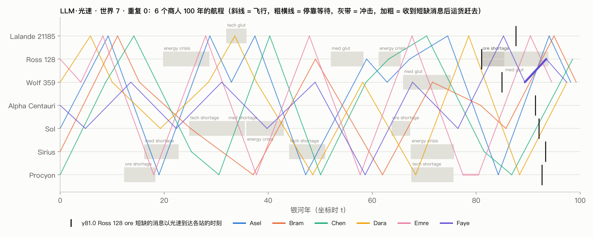
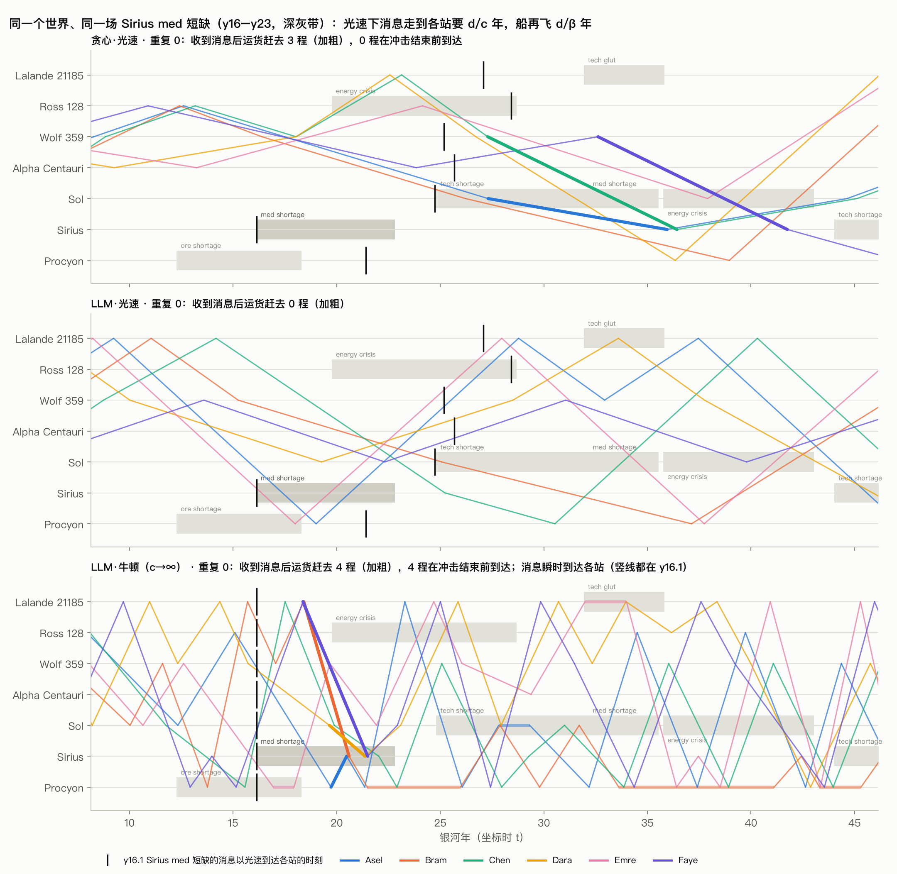
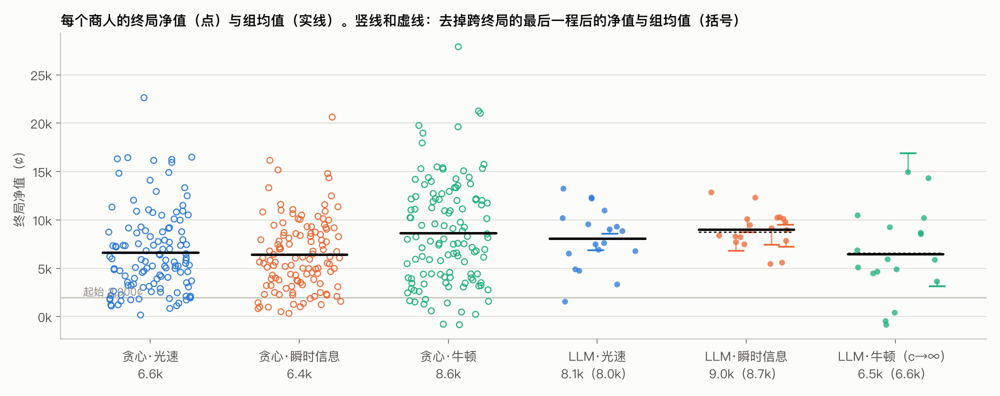
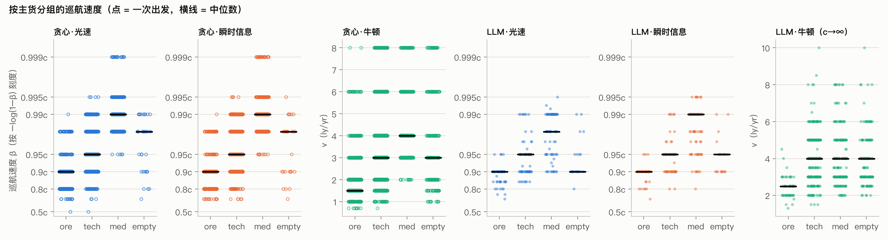
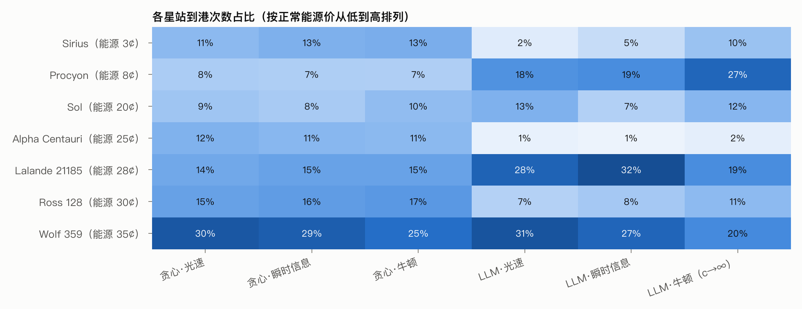
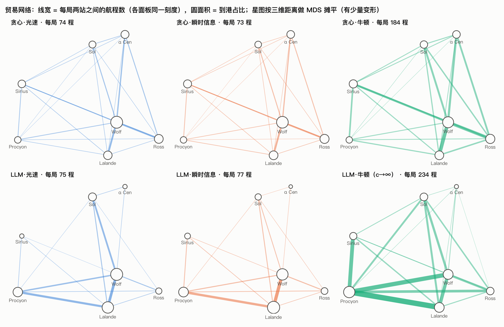
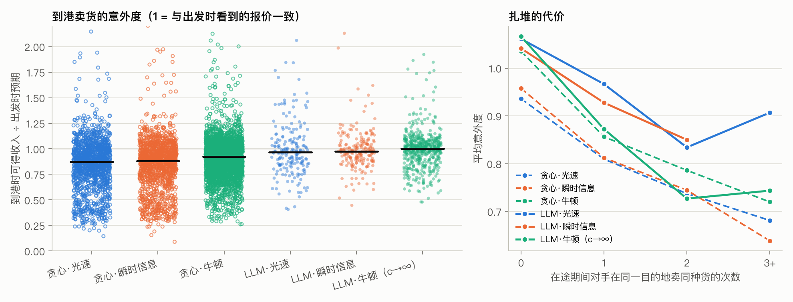
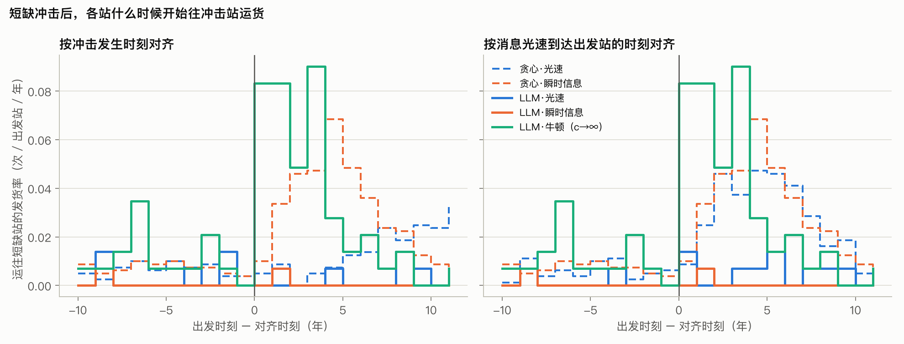
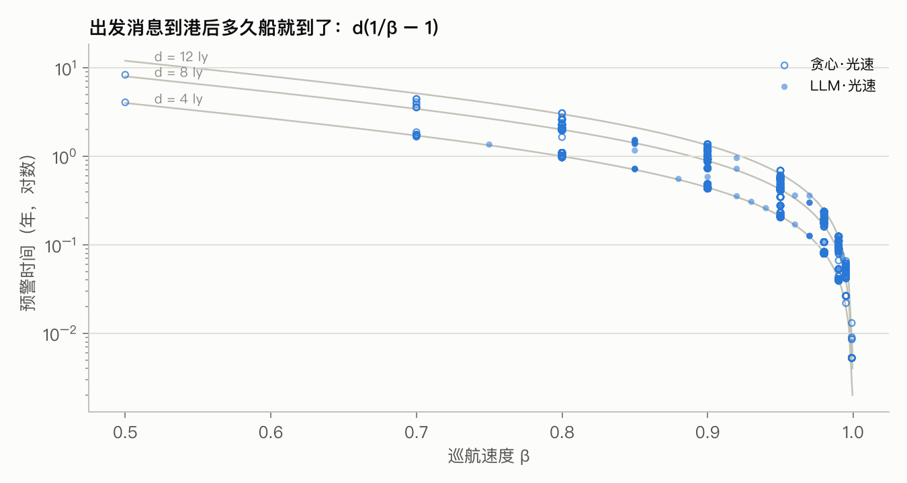
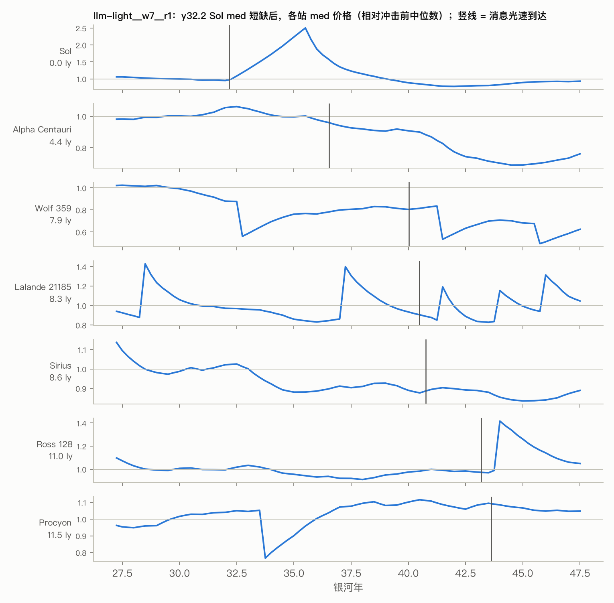

# 相对论星际贸易：实验数据报告

生成于 2026-10-21 04:16 · 69 局 · LLM：deepseek-v4.1-flash · 结论另见 README「发现」

## 总览

| 对照组 | 局数（世界） | 每局商人均净值 | 不计跨终局航程 | 终局在途 | 基尼 | 每局航程 | ore / tech / med 中位速度 | 意外度均值 | 意外度<0.8 | 到港没卖主货 | 预警<0.5 年 | 每局消息 | 平均船时 τ | 破产 | LLM 花费 |
|---|---|---|---|---|---|---|---|---|---|---|---|---|---|---|---|
| 贪心·光速 | 20（1,2,3,4,5,6,7,8,9,10,11,12,13,14,15,16,17,18,19,20） | 6,624 ± 1,855 | 6,624 ± 1,855 | 0% ± 0 | 0.30 ± 0.08 | 74.4 ± 2.8 | 0.888c / 0.95c / 0.987c | 0.85 ± 0.05 | 36% ± 7 | 0% ± 0 | 64% ± 7 | 0.0 ± 0.0 | 34.1 ± 2.3 | 0 | $0.00 |
| 贪心·瞬时信息 | 20（1,2,3,4,5,6,7,8,9,10,11,12,13,14,15,16,17,18,19,20） | 6,426 ± 1,650 | 6,426 ± 1,650 | 0% ± 0 | 0.28 ± 0.08 | 73.0 ± 3.8 | 0.888c / 0.95c / 0.988c | 0.85 ± 0.05 | 35% ± 11 | 0% ± 0 | 0% ± 0 | 0.0 ± 0.0 | 33.6 ± 2.4 | 0 | $0.00 |
| 贪心·牛顿 | 20（1,2,3,4,5,6,7,8,9,10,11,12,13,14,15,16,17,18,19,20） | 8,630 ± 1,742 | 8,630 ± 1,742 | 0% ± 0 | 0.30 ± 0.10 | 183.8 ± 12.3 | 1.65 / 3.08 / 3.75 | 0.91 ± 0.01 | 26% ± 4 | 0% ± 0 | 0% ± 0 | 0.0 ± 0.0 | 100.0 ± 0.0 | 2 | $0.00 |
| LLM·光速 | 3（7） | 8,077 ± 1,319 | 8,021 ± 1,369 | 11% ± 10 | 0.20 ± 0.03 | 75.0 ± 3.6 | 0.9c / 0.933c / 0.982c | 1.01 ± 0.05 | 19% ± 4 | 11% ± 3 | 56% ± 13 | 0.0 ± 0.0 | 36.5 ± 3.7 | 0 | $1.55 |
| LLM·瞬时信息 | 3（7） | 9,004 ± 1,225 | 8,747 ± 1,013 | 28% ± 19 | 0.09 ± 0.03 | 77.3 ± 3.5 | 0.892c / 0.95c / 0.988c | 1.00 ± 0.02 | 10% ± 5 | 14% ± 4 | 0% ± 0 | 0.3 ± 0.6 | 33.1 ± 2.6 | 0 | $1.87 |
| LLM·牛顿（c→∞） | 3（7） | 6,488 ± 1,246 | 6,572 ± 1,372 | 11% ± 19 | 0.33 ± 0.09 | 234.3 ± 10.1 | 2.5 / 3.92 / 3.83 | 1.00 ± 0.01 | 13% ± 2 | 24% ± 0 | 0% ± 0 | 0.0 ± 0.0 | 100.0 ± 0.0 | 0 | $7.20 |

「±」是跨局标准差。贪心组多世界 seed，用来估计世界之间的差异；LLM 组同一世界多次重复，差异来自采样随机性。意外度 = 到港那一刻按目的地真实报价卖掉主货能得的收入 ÷ 出发时按看到的报价算的预期，所有载货航程都算，与到港后卖不卖无关；「到港没卖主货」是到港后没在目的地卖主货（带走或囤着）的航程比例。「终局在途」是第 100 年还在飞的商人比例：规则让在途的货按目的地的终局报价清算（扣掉腐败），LLM 会专门在最后几年启程去一个终局之后才到的地方，贪心只选终局前能到的航程。「不计跨终局航程」把这最后一程换成「不出发、留在港口」：本站买进的货按买价退回，带过来的货按出发站当时的报价卖掉，退回能源和航程工资，改付停靠工资。比较 LLM 和贪心时以这一列为准。「平均船时 τ」是第 100 年那一刻的船时，仍在飞的商人按匀速插值。

## 行为

| 对照组 | 平均航距（ly） | 出发时目的地报价的年龄（年） | 每局等待次数 | 主货占比 ore / tech / med / 空船 | 每次短缺的追击航程 | 到港时冲击仍在 | 追击航程的意外度 | 消息到达后各站多买走的货 | 其中运往冲击站 |
|---|---|---|---|---|---|---|---|---|---|
| 贪心·光速 | 7.3 ± 0.2 | 7.3 ± 0.2 | 10.2 ± 2.2 | 29% / 45% / 24% / 2% | 1.64 ± 0.72 | 1% ± 2 | 0.51 ± 0.09 | +2.4 ± 2.0 | 9.6 ± 1.3 |
| 贪心·瞬时信息 | 7.5 ± 0.4 | 0.0 ± 0.0 | 11.5 ± 4.2 | 28% / 45% / 25% / 2% | 1.77 ± 0.69 | 6% ± 7 | 0.57 ± 0.08 | +5.8 ± 1.9 | 11.0 ± 1.6 |
| 贪心·牛顿 | 7.7 ± 0.2 | 0.0 ± 0.0 | 14.9 ± 3.7 | 31% / 47% / 16% / 6% | 3.61 ± 1.05 | 51% ± 17 | 0.85 ± 0.10 | +12.5 ± 2.7 | 24.2 ± 2.1 |
| LLM·光速 | 7.2 ± 0.4 | 7.2 ± 0.4 | 12.3 ± 1.2 | 22% / 35% / 33% / 10% | 0.29 ± 0.14 | 0% ± 0 | 0.74 ± 0.29 | +4.8 ± 5.3 | 2.6 ± 1.5 |
| LLM·瞬时信息 | 7.1 ± 0.2 | 0.0 ± 0.0 | 12.3 ± 3.8 | 18% / 35% / 37% / 10% | 0.04 ± 0.07 | 0% | 1.16 | -0.5 ± 4.2 | 0.7 ± 0.7 |
| LLM·牛顿（c→∞） | 8.1 ± 0.1 | 0.0 ± 0.0 | 27.0 ± 8.7 | 8% / 39% / 30% / 24% | 2.25 ± 0.54 | 86% ± 10 | 1.20 ± 0.11 | +6.5 ± 5.1 | 20.8 ± 4.7 |

「追击航程」：收到短缺消息后 8 年内，载着短缺的货出发前往冲击站的航程。光速下，远方的冲击从发生到船赶到至少要 d/c + d/β ≈ 2d 年。「消息到达后各站多买走的货」：短缺消息到达冲击站以外的某站之后 4 年，同一种货在那里被买走的单位数，减去消息到达之前 4 年的；所有（冲击，站）对合在一起，± 是标准误。远方的冲击只能通过这些买卖改变别处的价格，正常库存是 120–400 单位。「其中运往冲击站」是之后那段里同一次停靠就运往冲击站的量。

| 对照组 | 交易毛利 | 能源 | 航程工资 |
|---|---|---|---|
| 贪心·光速 | 7,737 ± 1,996 | 2,431 ± 249 | 637 ± 43 |
| 贪心·瞬时信息 | 7,594 ± 1,791 | 2,496 ± 385 | 615 ± 47 |
| 贪心·牛顿 | 17,425 ± 2,746 | 8,795 ± 1,251 | 1,913 ± 55 |
| LLM·光速 | 8,853 ± 1,592 | 2,230 ± 493 | 663 ± 87 |
| LLM·瞬时信息 | 8,514 ± 1,212 | 2,730 ± 423 | 584 ± 44 |
| LLM·牛顿（c→∞） | 19,426 ± 1,216 | 13,709 ± 1,796 | 1,791 ± 95 |

成本结构：每个商人平均的现金流（¢）。交易毛利 = 卖出收入 − 买入支出；航程工资在出发时按船时预付，停靠时另付停靠工资。终局都停靠时，净值 = 起始现金 + 交易毛利 − 能源 − 工资 × 船时 τ + 终局货值。

## 推理里提到了什么

每次停靠，模型写下的全部文字（推理 + 正文 + 工具参数）里是否出现某个概念的关键词，按停靠次数计百分比。关键词是粗筛：瞬时信息组和牛顿组的「信息过时」、牛顿组的「时间膨胀」本应为 0，它们的实际值可以当作误报率的参照。

| 概念 | LLM·光速 | LLM·瞬时信息 | LLM·牛顿（c→∞） |
|---|---|---|---|
| 信息过时 / 光速延迟 | 73% ± 9 | 2% ± 2 | 1% ± 1 |
| 时间膨胀（船时 vs 银河时） | 41% ± 6 | 51% ± 5 | 1% ± 1 |
| 预测到港时的行情 | 75% ± 4 | 66% ± 6 | 60% ± 3 |
| 对手 | 82% ± 5 | 75% ± 8 | 78% ± 1 |
| 药品腐败 | 91% ± 1 | 94% ± 2 | 80% ± 4 |
| 冲击（短缺 / 过剩 / 危机） | 85% ± 3 | 86% ± 3 | 84% ± 3 |
| 欺骗 / 虚张声势 | 3% ± 2 | 2% ± 2 | 1% ± 2 |
| 与对手合作 / 协调 | 2% ± 1 | 0% ± 1 | 0% ± 0 |

原文摘录（llm-light__w7__r0，每个概念取最早提到它的两位商人）：

- **信息过时 / 光速延迟** · Chen y0.0 @ Procyon：The snapshot is 8.66 years old.
- **信息过时 / 光速延迟** · Faye y0.0 @ Alpha Centauri：Let me re-read: "Sol 4.37 ly as of y-4.37 (4.37 y old)".
- **时间膨胀（船时 vs 银河时）** · Asel y0.0 @ Sol：β=0.9: γ factor 2.59, mass~2 -> 5.18*20=104¢ energy; ship time ~3.8y => wages 76.
- **时间膨胀（船时 vs 银河时）** · Chen y0.0 @ Procyon：β=0.5: Galactic time 17.32 y, ship time = d/(βγ) = 8.66/(0.5×1.1547) = 8.66/0.5774 = 15.0 ship y.
- **预测到港时的行情** · Bram y0.0 @ Sirius：But here's the thing: Wolf's med stock will rise as we dump med there (lowering price), and Lal's ore stock rises as we dump ore (lowering price).
- **预测到港时的行情** · Chen y0.0 @ Procyon：By the time we arrive (~9-17 years later), the stock may have changed and prices drift.
- **对手** · Asel y0.0 @ Sol：Rivals may affect markets by trading, causing prices.
- **对手** · Bram y0.0 @ Sirius：But actually there's an important consideration: we're competing against 5 rivals.
- **药品腐败** · Chen y0.0 @ Procyon：Med spoils though (half lost every 3 ship-years).
- **药品腐败** · Emre y0.0 @ Ross 128：Med spoils: half lost every 3 ship-years.
- **冲击（短缺 / 过剩 / 危机）** · Asel y0.0 @ Sol：At arrival after > years, stations may have normal stocks/prices except shocks.
- **冲击（短缺 / 过剩 / 危机）** · Bram y0.0 @ Sirius：Over time stations drift and shocks happen.
- **欺骗 / 虚张声势** · Emre y0.0 @ Ross 128：I could send misleading messages.
- **欺骗 / 虚张声势** · Asel y9.2 @ Lalande 21185：Could be useful for deception/coordination, but not necessary.
- **与对手合作 / 协调** · Asel y9.2 @ Lalande 21185：Cartel: Procyon(tech)→Ross(sell tech, buy med)→Wolf(sell med)→?

## 一局的世界线

示例局：每条斜线是一段航程，斜率越陡飞得越快；可以看到航线、扎堆和冲击期间的绕行。

## 追幽灵：同一场冲击，贪心 vs LLM

几局都是同一个世界（冲击和噪声完全相同），只截取冲击前后。加粗的是收到短缺消息后载着短缺的货赶往冲击站的航程。光速下，远方的冲击从发生到船赶到至少 d/c + d/β ≈ 2d 年，往往比冲击本身还长；有 LLM·牛顿局时放在最下面作对照（消息瞬时到达，船速没有上限）。

## 终局净值

推理（LLM vs 贪心）和物理（光速 vs 瞬时 vs 牛顿）各自的效果。

## 速度分层

相对论组的纵轴按 −log10(1−β) 刻度，0.9c / 0.99c / 0.999c 等距；牛顿组单位是 ly/yr。相对论下加速买到的主要是船时：7 光年从 0.888c 加速到 0.987c，银河时只省 10%，船时省 69%（工资和药品腐败按船时算），能量要 4.4 倍。

## 能源与枢纽

能源便宜的星站会不会成为枢纽。

## 贸易网络

谁和谁做生意。光速延迟下远方的报价更旧，贸易是否收缩到彼此近的星团里，对比同一行的光速列和瞬时信息列。

## 过时报价与扎堆

意外度 < 1：到港时目的地的真实报价比出发时看到的差（报价过时、对手先到、冲击结束）。按到港时刻的真实报价算，与到港后卖不卖无关。

## 信息波：冲击响应

左图按冲击时刻对齐：光速组的响应被各站距离抹开；右图按消息到达出发站的时刻对齐：响应应当在 0 点之后才出现、且突然出现。0 点之前的发货是常规航线的背景。

## 突袭：快船与自己的出发消息几乎同时到达

预警时间 = 到港时刻 − 出发消息光速到达目的地的时刻 = d(1/β − 1)。

## 一次冲击的价格场

竖线是冲击消息以光速到达各站的时刻；各站价格的扰动只能出现在竖线之后。

### 到港占比（%）

| 星站 | 正常能源价 | 贪心·光速 | 贪心·瞬时信息 | 贪心·牛顿 | LLM·光速 | LLM·瞬时信息 | LLM·牛顿（c→∞） |
|---|---|---|---|---|---|---|---|
| Sirius | 3¢ | 11 | 13 | 13 | 2 | 5 | 10 |
| Procyon | 8¢ | 8 | 7 | 7 | 18 | 19 | 27 |
| Sol | 20¢ | 9 | 8 | 10 | 13 | 7 | 12 |
| Alpha Centauri | 25¢ | 12 | 11 | 11 | 1 | 1 | 2 |
| Lalande 21185 | 28¢ | 14 | 15 | 15 | 28 | 32 | 19 |
| Ross 128 | 30¢ | 15 | 16 | 17 | 7 | 8 | 11 |
| Wolf 359 | 35¢ | 30 | 29 | 25 | 31 | 27 | 20 |

## 每局明细

| run | 均净值 | 最低 / 最高 | 航程 | 空船 | 意外度 | 消息 | 最大并发 | 墙钟 | LLM 调用 | 花费 |
|---|---|---|---|---|---|---|---|---|---|---|
| greedy-light__w1__r0 | 4,742 | 3,368 / 7,193 | 72 | 1 | 0.82 | 0 | 6 | 0.0 min | – | $0.00 |
| greedy-light__w2__r0 | 8,954 | 2,897 / 22,635 | 78 | 1 | 0.86 | 0 | 6 | 0.0 min | – | $0.00 |
| greedy-light__w3__r0 | 10,142 | 4,642 / 16,250 | 76 | 1 | 0.96 | 0 | 6 | 0.0 min | – | $0.00 |
| greedy-light__w4__r0 | 3,092 | 847 / 7,693 | 74 | 5 | 0.84 | 0 | 6 | 0.0 min | – | $0.00 |
| greedy-light__w5__r0 | 4,984 | 2,112 / 7,364 | 75 | 1 | 0.85 | 0 | 6 | 0.0 min | – | $0.00 |
| greedy-light__w6__r0 | 4,720 | 1,619 / 11,045 | 74 | 0 | 0.75 | 0 | 6 | 0.0 min | – | $0.00 |
| greedy-light__w7__r0 | 5,810 | 1,748 / 8,883 | 73 | 1 | 0.83 | 0 | 6 | 0.0 min | – | $0.00 |
| greedy-light__w8__r0 | 5,079 | 1,877 / 9,126 | 72 | 0 | 0.81 | 0 | 6 | 0.0 min | – | $0.00 |
| greedy-light__w9__r0 | 5,308 | 1,399 / 15,944 | 72 | 1 | 0.83 | 0 | 6 | 0.0 min | – | $0.00 |
| greedy-light__w10__r0 | 8,491 | 1,760 / 13,332 | 78 | 3 | 0.86 | 0 | 6 | 0.0 min | – | $0.00 |
| greedy-light__w11__r0 | 4,187 | 1,121 / 8,738 | 78 | 5 | 0.82 | 0 | 6 | 0.0 min | – | $0.00 |
| greedy-light__w12__r0 | 8,064 | 1,107 / 16,151 | 71 | 1 | 0.85 | 0 | 6 | 0.0 min | – | $0.00 |
| greedy-light__w13__r0 | 8,245 | 1,217 / 14,826 | 72 | 1 | 0.90 | 0 | 6 | 0.0 min | – | $0.00 |
| greedy-light__w14__r0 | 6,299 | 167 / 16,486 | 73 | 1 | 0.80 | 0 | 6 | 0.0 min | – | $0.00 |
| greedy-light__w15__r0 | 7,189 | 3,960 / 14,901 | 73 | 1 | 0.91 | 0 | 6 | 0.0 min | – | $0.00 |
| greedy-light__w16__r0 | 7,839 | 3,125 / 12,936 | 77 | 0 | 0.82 | 0 | 6 | 0.0 min | – | $0.00 |
| greedy-light__w17__r0 | 6,650 | 2,528 / 11,496 | 76 | 1 | 0.89 | 0 | 6 | 0.0 min | – | $0.00 |
| greedy-light__w18__r0 | 6,457 | 2,630 / 9,163 | 76 | 2 | 0.82 | 0 | 6 | 0.0 min | – | $0.00 |
| greedy-light__w19__r0 | 8,118 | 2,251 / 16,438 | 79 | 4 | 0.86 | 0 | 6 | 0.0 min | – | $0.00 |
| greedy-light__w20__r0 | 8,104 | 1,822 / 16,313 | 69 | 0 | 0.87 | 0 | 6 | 0.0 min | – | $0.00 |
| greedy-ansible__w1__r0 | 6,354 | 828 / 10,990 | 75 | 2 | 0.80 | 0 | 1 | 0.0 min | – | $0.00 |
| greedy-ansible__w2__r0 | 8,357 | 3,841 / 20,630 | 69 | 2 | 0.89 | 0 | 1 | 0.0 min | – | $0.00 |
| greedy-ansible__w3__r0 | 8,332 | 2,329 / 15,167 | 76 | 1 | 0.94 | 0 | 1 | 0.0 min | – | $0.00 |
| greedy-ansible__w4__r0 | 6,128 | 2,217 / 8,693 | 72 | 4 | 0.89 | 0 | 1 | 0.0 min | – | $0.00 |
| greedy-ansible__w5__r0 | 4,750 | 1,444 / 8,726 | 71 | 1 | 0.80 | 0 | 1 | 0.0 min | – | $0.00 |
| greedy-ansible__w6__r0 | 4,970 | 1,267 / 8,287 | 77 | 0 | 0.79 | 0 | 1 | 0.0 min | – | $0.00 |
| greedy-ansible__w7__r0 | 6,056 | 1,868 / 10,892 | 70 | 0 | 0.78 | 0 | 1 | 0.0 min | – | $0.00 |
| greedy-ansible__w8__r0 | 4,565 | 1,241 / 7,804 | 69 | 0 | 0.80 | 0 | 1 | 0.0 min | – | $0.00 |
| greedy-ansible__w9__r0 | 3,252 | 336 / 6,764 | 73 | 1 | 0.81 | 0 | 1 | 0.0 min | – | $0.00 |
| greedy-ansible__w10__r0 | 6,015 | 1,018 / 11,073 | 77 | 0 | 0.85 | 0 | 1 | 0.0 min | – | $0.00 |
| greedy-ansible__w11__r0 | 4,386 | 1,006 / 9,039 | 69 | 4 | 0.86 | 0 | 1 | 0.0 min | – | $0.00 |
| greedy-ansible__w12__r0 | 7,751 | 5,184 / 13,326 | 76 | 1 | 0.82 | 0 | 1 | 0.0 min | – | $0.00 |
| greedy-ansible__w13__r0 | 4,935 | 506 / 10,122 | 72 | 1 | 0.80 | 0 | 1 | 0.0 min | – | $0.00 |
| greedy-ansible__w14__r0 | 7,119 | 3,085 / 11,607 | 67 | 4 | 0.85 | 0 | 1 | 0.0 min | – | $0.00 |
| greedy-ansible__w15__r0 | 6,015 | 3,528 / 9,185 | 70 | 2 | 0.91 | 0 | 1 | 0.0 min | – | $0.00 |
| greedy-ansible__w16__r0 | 9,263 | 7,761 / 10,822 | 81 | 1 | 0.90 | 0 | 1 | 0.0 min | – | $0.00 |
| greedy-ansible__w17__r0 | 7,884 | 2,282 / 14,792 | 79 | 0 | 0.88 | 0 | 1 | 0.0 min | – | $0.00 |
| greedy-ansible__w18__r0 | 8,726 | 2,087 / 16,161 | 76 | 0 | 0.91 | 0 | 1 | 0.0 min | – | $0.00 |
| greedy-ansible__w19__r0 | 6,156 | 2,301 / 14,348 | 71 | 2 | 0.84 | 0 | 1 | 0.0 min | – | $0.00 |
| greedy-ansible__w20__r0 | 7,504 | 3,676 / 11,581 | 71 | 0 | 0.91 | 0 | 1 | 0.0 min | – | $0.00 |
| greedy-newton__w1__r0 | 10,197 | 4,014 / 15,295 | 205 | 19 | 0.91 | 0 | 1 | 0.0 min | – | $0.00 |
| greedy-newton__w2__r0 | 11,403 | 1,782 / 19,623 | 179 | 12 | 0.92 | 0 | 1 | 0.0 min | – | $0.00 |
| greedy-newton__w3__r0 | 8,397 | 598 / 15,740 | 180 | 14 | 0.92 | 0 | 1 | 0.0 min | – | $0.00 |
| greedy-newton__w4__r0 | 6,665 | 242 / 13,977 | 181 | 16 | 0.91 | 0 | 1 | 0.0 min | – | $0.00 |
| greedy-newton__w5__r0 | 9,270 | 1,579 / 15,483 | 193 | 9 | 0.91 | 0 | 1 | 0.0 min | – | $0.00 |
| greedy-newton__w6__r0 | 7,189 | -785 / 19,766 | 179 | 10 | 0.88 | 0 | 1 | 0.0 min | – | $0.00 |
| greedy-newton__w7__r0 | 7,672 | 1,288 / 15,317 | 192 | 25 | 0.90 | 0 | 1 | 0.0 min | – | $0.00 |
| greedy-newton__w8__r0 | 7,263 | 3,442 / 11,130 | 186 | 12 | 0.93 | 0 | 1 | 0.0 min | – | $0.00 |
| greedy-newton__w9__r0 | 7,721 | 2,772 / 13,565 | 191 | 7 | 0.90 | 0 | 1 | 0.0 min | – | $0.00 |
| greedy-newton__w10__r0 | 7,178 | 2,709 / 14,374 | 183 | 13 | 0.89 | 0 | 1 | 0.0 min | – | $0.00 |
| greedy-newton__w11__r0 | 5,806 | 473 / 12,162 | 164 | 11 | 0.90 | 0 | 1 | 0.0 min | – | $0.00 |
| greedy-newton__w12__r0 | 10,492 | -835 / 15,398 | 169 | 6 | 0.90 | 0 | 1 | 0.0 min | – | $0.00 |
| greedy-newton__w13__r0 | 10,409 | 3,227 / 17,955 | 201 | 13 | 0.91 | 0 | 1 | 0.0 min | – | $0.00 |
| greedy-newton__w14__r0 | 7,887 | 3,488 / 14,194 | 187 | 9 | 0.90 | 0 | 1 | 0.0 min | – | $0.00 |
| greedy-newton__w15__r0 | 7,835 | 3,060 / 21,029 | 181 | 10 | 0.90 | 0 | 1 | 0.0 min | – | $0.00 |
| greedy-newton__w16__r0 | 10,700 | 3,510 / 21,262 | 206 | 11 | 0.90 | 0 | 1 | 0.0 min | – | $0.00 |
| greedy-newton__w17__r0 | 10,316 | 6,386 / 13,658 | 188 | 11 | 0.91 | 0 | 1 | 0.0 min | – | $0.00 |
| greedy-newton__w18__r0 | 6,441 | 1,636 / 11,552 | 176 | 9 | 0.91 | 0 | 1 | 0.0 min | – | $0.00 |
| greedy-newton__w19__r0 | 11,385 | 5,792 / 18,972 | 177 | 8 | 0.94 | 0 | 1 | 0.0 min | – | $0.00 |
| greedy-newton__w20__r0 | 8,375 | 1,409 / 27,904 | 159 | 8 | 0.90 | 0 | 1 | 0.0 min | – | $0.00 |
| llm-light__w7__r0 | 9,493 | 4,894 / 13,228 | 72 | 8 | 1.06 | 0 | 6 | 40.6 min | 303 | $0.59 |
| llm-light__w7__r1 | 6,883 | 1,545 / 9,544 | 79 | 6 | 1.01 | 0 | 6 | 32.2 min | 279 | $0.46 |
| llm-light__w7__r2 | 7,855 | 3,327 / 12,313 | 74 | 8 | 0.96 | 0 | 6 | 32.0 min | 279 | $0.50 |
| llm-ansible__w7__r0 | 10,145 | 7,699 / 12,845 | 81 | 4 | 0.99 | 0 | 1 | –（续跑） | 302 | $0.53 |
| llm-ansible__w7__r1 | 9,158 | 7,472 / 10,278 | 77 | 7 | 1.02 | 1 | 1 | 112.9 min | 294 | $0.75 |
| llm-ansible__w7__r2 | 7,709 | 5,444 / 9,757 | 74 | 11 | 0.99 | 0 | 1 | 89.8 min | 264 | $0.59 |
| llm-newton__w7__r0 | 5,223 | -465 / 8,668 | 246 | 67 | 0.99 | 0 | 1 | –（续跑） | 822 | $2.81 |
| llm-newton__w7__r1 | 7,713 | 3,631 / 14,937 | 228 | 44 | 1.00 | 0 | 1 | –（续跑） | 718 | $2.20 |
| llm-newton__w7__r2 | 6,529 | -850 / 14,309 | 229 | 55 | 1.00 | 0 | 1 | 231.1 min | 739 | $2.19 |

「续跑」：这一局中途因上游错误中止，之后从缓存逐字节重放到中止处再继续，墙钟只覆盖最后一次运行。花费按每个响应当初请求时的价格计，与是否重放无关。

## 商人之间的消息（摘录）

**llm-ansible__w7__r1**

- y21.9 Dara @ Lalande 21185 → all：Dara here. Heads up: the Sirius epidemic is the real prize — med bid hit 199¢ at Sirius (stock collapsed 250->59) and it runs to ~y23 with a slow recovery after. Anyone within reach of Sirius should be running medicine there hard. Procyon is close to Sirius (5.26 ly) and has 49¢ med. Also FYI Wolf 3

## 终局笔记本（摘录）

**llm-ansible__w7__r0**

- Asel（净值 10,112¢，船时 30.3 年）：FINAL: y99.93, docked Procyon, cash 10,113¢, empty hold. NET WORTH ~10,113¢ (started 2000 = 5.06x). Key trades that built the bank: Sol tech->Lalande; Procyon tech->Wolf (x many); Ross med bump->Procyon; final Lalande med->Procyon 160u @0.99c netted ~+1000. LESSONS: move goods cheap->dear net of energy+wages+spoilage; med spoils (use 0.99c on long hauls, 73% survives); tech light/no-spoil but buy 
- Bram（净值 10,084¢，船时 31.8 年）：Y73.56 Lalande, cash 7157. 26.4y left. End year 100 docked in CASH. LOOP: Lalande med(~14, light 0.003/u) -> Wolf 359 (~40 bid, 4.07ly, ~30% spoil at 0.95). Wolf ore(~4.3) -> Lalande (~8.5). Wolf med glut clears ~y75. Timing: Lal->Wolf 0.95=4.29y; Wolf->Lal 0.9=4.52y. ~3-4 round trips to y100. Lesson: watch price-impact on big orders (fills along curve). Don't overbuy; keep cash buffer for energy+
- Chen（净值 7,832¢，船时 27.7 年）：STATUS y33: at Lalande, 95 cash, 78 tech (cost basis 42.2). Can't afford departure (energy 30.5 here is pricey). KEY: "Tech glut at Lalande" shock (y31.93, ~4yr -> fades ~y35.9) crashed tech bid to 37 (< my cost). Do NOT sell now. WAIT for glut to fade, tech recovers toward ~70, then sell (~4300), then buy cheap Lalande MED (~14-17) for Procyon (~45). This station is my engine: cheap med source + 
- Dara（净值 12,845¢，船时 34.8 年）：FINAL: y98.26 docked aCen, liquidated all ore -> cash 12,880, empty hold. Net worth ~12.8k (started 2,000; 6.4x). Waiting to y100. Summary of what worked: (1) Front-loaded Wolf->Lalande ore carried, then med flips in Wolf cluster. (2) The big winner: TECH arbitrage Procyon(cheap 28-40) -> Wolf/Lalande/Sirius (pay 80-144 during shortages). Zero spoilage, light cargo. (3) Caught Sirius tech shortage
- Emre（净值 12,300¢，船时 37.4 年）：DONE. Sold final 277 med for 7,550. Cash 12,414 (6.2x start of 2,000). Hold empty. Waiting docked at Wolf to y100. No further trades - no time for safe round trip. Final net worth = 12,414 cash.
- Faye（净值 7,699¢，船时 35.2 年）：NORMAL PRICES (ask/bid): Sol ore12.2/11.8 tech43.3/41.6 med32.6/31.4 E20.4 | AC ore13.3/12.7 tech45.9/44.1 med40.8/39.2 E25.5 | Wolf ore5.63/5.41 tech76.5/73.5 med45.9/44.1 E35.9 | Lal ore9.18/8.82 tech76.5/73.5 med14.3/13.7 E28.6 | Ross ore7.42/7.13 tech81.6/78.4 med20.4/19.6 E30.9 | Sirius ore13.3/12.7 tech61.2/58.8 med49/47 E3.07 | Proc ore10.2/9.8 tech40.8/39.2 med51/49 E8.18. KEY SHUTTLE: Pro

**llm-ansible__w7__r1**

- Asel（净值 9,134¢，船时 25.1 年）：Endgame plan (y96): I finish in flight; cargo valued at destination prices after spoilage. - Checked all options: min distance from Lalande is 4.07 ly, so no arrival before y100 anywhere. - Med destinations at y100: Procyon ~47 bid (stock 268/normal 250, nobody flooding it) beats Sol ~31 and Sirius (Bram lands 260 med there y99.84 → collapses). - Departing Lalande→Procyon at 0.995c, 215 med (80% s
- Bram（净值 8,376¢，船时 24.2 年）：STRATEGY: Sirius=cheap-energy home base (energy 3.06). Run goods from cheap sources to high-demand stations. Goods: tech cheap @Procyon(32.6) & Sol(43.5); high @Ross(81.6),Wolf(73.5),Lalande(76.5). Ore cheap @Wolf(4.08),Ross(5.1); high @Sol(12.2),Sirius(12.7),aCen(13.3). Med cheap @Lalande(14.3); high @Procyon(49),Sirius(47) — but spoils fast, needs high speed. Stocks recover ~2y. Keep cash reserv
- Chen（净值 10,221¢，船时 31.1 年）：FINAL POSITION: Docked at Wolf 359, year 98.52. Sold all 292.87 med @7141. CASH = 10,251¢. Hold empty. Net worth grew 2,000 -> 10,251 (5.1x).  Final move: wait remaining 1.48yr to year 100 in cash (buying anything now = lose 4% spread on liquidation, so stay cash).  KEY LESSONS LEARNED this run: - Tech = best vehicle (no spoil, huge cheap->expensive spread: Procyon/Sol ~30 buy -> Wolf/Ross/Lalande
- Dara（净值 9,465¢，船时 37.9 年）：=== DARA — TRADING NOTES (y63) === CASH 6568. 36.7y left. Goal: max cash+cargo at y100.  VALUE MAP (normal ask/bid @ normal stock S): TECH: Procyon 32.6/31.3(S250) | Sol 35.8/34.3(S250) | aCen 46/44.1 | Sirius 61.2/58.8 | Lalande 76.5/73.3(S120) | Wolf 76.5/73.7(S120) | Ross 81.8/78.6(S120) MED: Lalande 14.3/13.7(S400 DEEPEST) | Ross 20.4/19.5(S350) | Sol 32.6/31.4 | aCen 40.8/39.3 | Wolf 45.9/44.
- Emre（净值 10,278¢，船时 31.5 年）：FINISHED. Final: docked Wolf 359, empty hold, CASH 10,329¢ at y97.46 (<y100). Net worth ~10,329¢ (started 2,000 = ~5.2x). A journey of profitable arbitrage: exploited rotating shocks (Procyon ore shortage +884, Sirius med epidemic, Wolf/Ross tech shortages) and structural spreads (Procyon/Sol cheap tech -> Wolf/Ross high tech bid, no spoilage; Lalande cheap med -> Procyon/Sirius). Lessons: trade o
- Faye（净值 7,472¢，船时 33.9 年）：FINAL RESULT: Started 2,000¢ at Alpha Centauri (y0). Finished ~7,477¢ cash, empty hold, docked at Lalande 21185 at y99.77 (~3.7x net worth). WHAT WORKED: - Tech arbitrage from cheap sources to high-bid sinks: Sol(~32-38)->Wolf(~76)/Lalande(~64), Procyon(~25)->Lalande(~86). Biggest single wins: tech to Wolf (+1,268), tech to Lalande (+1,678 & +3,929 legs). - Medicine Lalande(cheap ~15)->Wolf/Procyo

**llm-ansible__w7__r2**

- Asel（净值 8,219¢，船时 46.9 年）：=== FINAL: y98.42, 1.58yr left, at Lalande, CASH 8251, empty === Sold final ore 120@773. Complete. No trip possible in 1.58yr (min 4.07ly). Don't buy cargo (would forfeit bid/ask spread at liquidation). Cash is optimal. Just WAIT 1.58yr to year 100. Net worth finalizes = 8251¢. JOURNEY RECAP (started 2000, ended 8251, ~4.1x):  R1 y0 Sol: buy tech (cheap source).   R2 y12 Ross, R3 y17 Wolf: sold te
- Bram（净值 5,444¢，船时 32.1 年）：ENDGAME PLAN (from y85.4, at Sol, cash 5,665). Timing: 14.62 y left. Flight Sol->Ross 11.01 ly takes 11.12 y at 0.99c. So I can wait W years, then fly, arriving y85.38+W+11.12 <= 100 => W <= 3.5.  Sol tech ask is currently INFLATED (53.7, stock 166 vs normal 250) because Dara bought 130 at y84.4. It reverts toward ask 35 with ~2y time constant: S(W)=250-84*e^(-W/2), ask=8914/S. Buying tech now wou
- Chen（净值 8,958¢，船时 39.8 年）：FINAL: Cash 9,062¢ at Wolf 359, empty hold. Started 2,000 -> 9,062 (4.5x). Reliable edge = tech arbitrage: buy cheap tech at Procyon/Sol (~26-40), sell at tech-hungry Wolf 359/Ross 128 (~60-88). Tech never spoils, tiny mass. Ore triangle Wolf->Sol/Sirius also worked. KEY LESSONS: (1) Don't dump large qty into thin markets - split or price crushes. (2) Fast c=0.9-0.95 good balance; slow cheap when 
- Dara（净值 8,296¢，船时 36.5 年）：FINAL STATE: Docked Wolf 359, year 97.26. Cash 8,351¢, empty hold. Net worth = cash (empty hold) ≈ 8,351¢ at liquidation.  Journey highlights: - Start 2,000¢ at Wolf. Ore->Sirius, tech->Lalande, med loops. Doubled to ~4,500 by mid-game. - Biggest win: Ross 128 med glut (~10/unit, 333 units) sold at Procyon (58 bid) for +7,255¢ profit. Peak cash ~7,400 at y80. - KEY LESSON: large orders get crushed
- Emre（净值 9,757¢，船时 32.6 年）：FINAL MOVE y97.42: Bought 300 med @Lalande (avg22.8, cost6850), cash 2749, hold 300 med, mass1.9M. Departed Sirius 0.99c. Energy675+wages31=706 prepaid. Cash after ~2043. At y100 IN FLIGHT (arrive y108.5, never arrive): remaining flight 2.58 gal yr => ship time 2.58/γ(0.99=7.09)=0.364 yr => med survives 0.5^(0.364/3)=91.9% => ~276 units. Liquidate at SIRIUS bid ~47.9 (stock246/250 near-normal, no 
- Faye（净值 5,581¢，船时 27.3 年）：FINAL at Ross 128, y98.27. Sold final 55 tech for 3,551. CASH 5,616, empty hold. Net worth at year 100 = 5,616¢ (cash), up from 2,000 start (+181%). ~1.7yr left, no trip possible, buying cargo here = instant spread loss, so done. Best trades: bought tech cheap (Procyon/Sol), sold high at left-lobe sinks (Lalande 76-82, Ross 78-90, Wolf 84). Med as backhaul (spoilage limited its edge).

